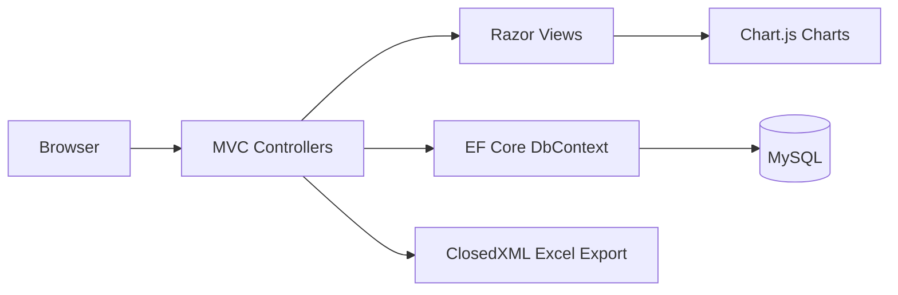
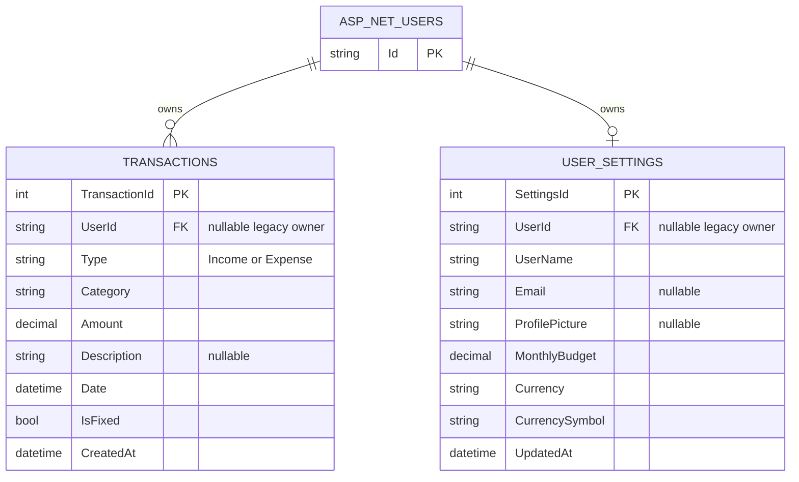

# Expense Tracker 💰

A personal finance web app built with ASP.NET Core MVC and MySQL to record income and expenses, track a monthly budget, and export monthly reports to Excel.

---

## Summary and Problem

Many people track spending in notes apps or memory, and at the end of the month they cannot say where the money went. Spreadsheets work, but they need manual formulas and are tedious to keep up.

Expense Tracker gives one place to log income and expenses, mark recurring (fixed) expenses, set a monthly budget, and see the month as charts and category totals. Any month's data can be downloaded as a formatted Excel report.

## Features

- **Dashboard:** total income, total expense, and balance for the selected month, with a 6-month income vs. expense trend and category charts
- **Accounts:** register, log in, and log out. Dashboards, reports, transactions, and settings are scoped to the signed-in account.
- **Add and edit expenses:** categories include Food, Transport, Shopping, Entertainment, Health, Education, Bills, Rent, and Other
- **Add and edit income:** categories include Salary, Business, Freelance, Investment, Gift, Bonus, and Other
- **Fixed expenses:** mark an expense as recurring and view fixed expenses by month with category totals
- **Monthly overview:** view all transactions for any of the last 12 months, with income and expense breakdowns by category
- **Excel export:** download a monthly report with a Summary sheet and an All Transactions sheet (built with ClosedXML)
- **Budget tracking:** set a monthly budget and see the amount spent, the amount remaining, and the percentage used
- **Currency settings:** choose BDT, USD, EUR, GBP, or INR; the symbol updates across the app

## Architecture



- The app follows the **MVC** pattern: controllers handle requests, Razor views render pages, and models map to database tables.
- `BaseController` loads the user's currency settings and passes them to every view.
- Entity Framework Core talks to MySQL through `ApplicationDbContext`, with schema changes managed by migrations.
- Charts are drawn in the browser with Chart.js from data prepared by the controllers.

## Database (ERD)



ASP.NET Core Identity stores accounts in the same database. Both tables carry an owner ID, and each account can have one settings row.

## Tech Stack

| Layer | Technology |
|---|---|
| Framework | ASP.NET Core MVC (.NET 8) |
| Language | C# |
| Database | MySQL |
| ORM | Entity Framework Core 8 with Pomelo MySQL provider |
| Frontend | Razor views, Bootstrap, jQuery, Chart.js |
| Excel export | ClosedXML |
| Icons | Font Awesome |

## Project Structure

```
ExpenseTracker/
├── ExpenseTracker.sln
└── ExpenseTracker/
    ├── Controllers/
    │   ├── BaseController.cs          # Loads currency settings for all views
    │   ├── HomeController.cs          # Dashboard and charts
    │   ├── ExpenseController.cs       # Add expense, fixed expenses
    │   ├── IncomeController.cs        # Add and delete income
    │   ├── MonthlyOverviewController.cs   # Monthly view and Excel export
    │   └── SettingsController.cs      # Budget, currency, profile
    ├── Models/
    │   ├── Transaction.cs
    │   └── UserSettings.cs
    ├── Data/
    │   └── ApplicationDbContext.cs
    ├── Migrations/                    # EF Core migrations
    ├── Views/                         # Razor views per controller
    ├── wwwroot/                       # CSS, JS, static libraries
    ├── appsettings.json               # Connection string
    └── Program.cs
```

## Run locally from VS Code

Install the .NET 8 SDK and start MySQL 8. From the repository root in PowerShell, configure a local database account and run:

```powershell
$project = '.\ExpenseTracker\ExpenseTracker\ExpenseTracker.csproj'
$db = Get-Credential -Message 'Enter your MySQL username and password'
$connection = [System.Data.Common.DbConnectionStringBuilder]::new()
$connection['Server'] = '127.0.0.1'
$connection['Database'] = 'ExpenseDB'
$connection['User ID'] = $db.UserName
$connection['Password'] = $db.GetNetworkCredential().Password
@{ 'ConnectionStrings:DefaultConnection' = $connection.ConnectionString } |
    ConvertTo-Json -Compress |
    dotnet user-secrets set --project $project
dotnet tool restore
dotnet tool run dotnet-ef -- database update --project $project -- --environment Development
dotnet run --project $project
```

Open <http://localhost:8080> and register an account. Run the migration with an account permitted to modify the schema. Use a least-privilege account for the running application wherever migration privileges can be separated.

### Verify Phase 1

The integration tests use MySQL 8. Set `EXPENSETRACKER_TEST_MYSQL` to the connection string for a test-only server with permission to create schemas. The suite creates two uniquely named `expense_tracker_test_*` schemas per run and leaves them available for inspection.

```powershell
$project = '.\ExpenseTracker\ExpenseTracker\ExpenseTracker.csproj'
$solution = '.\ExpenseTracker\ExpenseTracker.sln'
dotnet tool restore
dotnet build $solution
dotnet test $solution --no-build -- RunConfiguration.TreatNoTestsAsError=true
dotnet tool run dotnet-ef -- migrations has-pending-model-changes --project $project -- --environment Development
dotnet tool run dotnet-ef -- migrations script 20260118182451_AddUserSettings --project $project --output "$env:TEMP/expense-tracker-phase1.sql" -- --environment Development
```

### Upgrade an existing database

Back up your database and rehearse the upgrade against a restored copy. The migration adds Identity tables, nullable owner columns, foreign keys, and indexes. Existing IDs, transaction values, and settings remain in place. Rows with a null owner are hidden from signed-in users. Assign legacy rows only after confirming ownership and reviewing a repeatable backfill for the intended account.

During rollout, take the old app offline before applying the reviewed migration. Verify row counts, totals, and ownership on the restored copy before applying the migration to the live database.

### Assign legacy transactions and settings

Confirm the destination account with the data owner and resolve its sign-in email to its Identity user ID. Prepare a reviewed list of unassigned transaction IDs and settings row IDs for each destination account. Record transaction counts and totals for each group before asking the data owner to approve the assignment. A new registration grants access only to records owned by that account.

Back up the database and rehearse the approved assignment on a restored copy. Apply the assignments in a separate transaction that updates only rows whose owner is still null. If an account already has settings, preserve both records and resolve the conflict explicitly before assigning the legacy settings row. Check that the updated counts and totals match the approved list and that other accounts see only their own data. Keep ambiguous records unassigned.

## API Overview

This is a server-rendered MVC app, so it exposes pages and form actions rather than a JSON API.

| Route | Method | Purpose |
|---|---|---|
| `/` or `/Home/Index?month=&year=` | GET | Dashboard for a month |
| `/Expense/AddExpense` | GET, POST | Show the form / save an expense |
| `/Expense/FixedExpense?month=&year=` | GET | Fixed expenses for a month |
| `/Expense/DeleteFixedExpense/{id}` | POST | Delete an owned fixed expense |
| `/Income/Index?month=&year=` | GET | Income list and form for a month |
| `/Income/AddIncome` | POST | Save an income |
| `/Income/DeleteIncome/{id}` | POST | Delete an owned income |
| `/Transactions/Edit/{id}` | GET, POST | Edit owned income or expense |
| `/MonthlyOverview/Index?month=&year=` | GET | All transactions for a month |
| `/MonthlyOverview/ExportToExcel?month=&year=` | GET | Download the Excel report |
| `/Settings/Index` | GET | View settings and budget usage |
| `/Settings/UpdateSettings` | POST | Save settings |
| `/Account/Register`, `/Account/Login` | GET, POST | Register or sign in |
| `/Account/Logout` | POST | Sign out |
| `/health` | GET | Anonymous health probe |

## Deployment

For a Render Free Docker Web Service, follow the [Render deployment guide](docs/render-deployment.md) for MySQL TLS setup, environment variables, database initialization, and session persistence.

### Other hosts

1. Build the existing Dockerfile for Railway, or publish with `dotnet publish -c Release`.
2. Configure `ConnectionStrings__DefaultConnection` as a deployment secret. Railway's `MYSQL_URL` is also supported. Use a least-privilege database account for runtime and rotate any credential previously stored in the repository.
3. Apply the reviewed migration separately with a deployment credential. The app starts without applying migrations automatically.
4. Serve the app over HTTPS and use `/health` for the host health probe. Persist ASP.NET Core Data Protection keys across restarts where users need sessions to survive redeployment.

## Key Decisions

- **ASP.NET Core MVC with Razor views:** keeps the app simple, with server-side rendering and no separate frontend project.
- **One `Transaction` table for both income and expenses:** a `Type` column separates them, which makes monthly totals and reports simple queries.
- **`IsFixed` flag for recurring expenses:** a single boolean marks fixed expenses without a separate recurring-payments table.
- **Entity Framework Core migrations:** schema changes are tracked in code and are easy to reproduce on another machine.
- **`BaseController` for shared settings:** the currency symbol is loaded in one place instead of repeated in every controller.
- **ClosedXML for export:** produces formatted Excel files without needing Excel installed on the server.

## Known Limitations

- Fixed expenses are flagged entries and still need to be entered for each month.
- Currency settings change the display symbol. Historical amounts retain their original numeric values.
- Legacy rows need an explicit ownership assignment before they appear in the app.

## Next Improvements

- Automatically create fixed expenses for each month.
- Add per-category budgets and alerts.

## Contributing

Contributions, issues, and feature requests are welcome. Check the [issues page](https://github.com/arrahmanriju/ExpenseTracker/issues).

## License

`<add your license, for example
