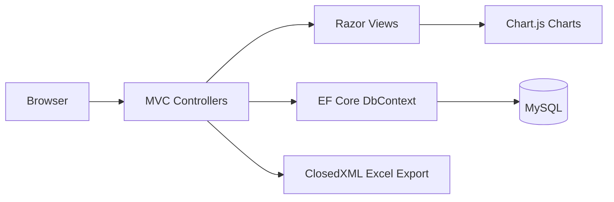
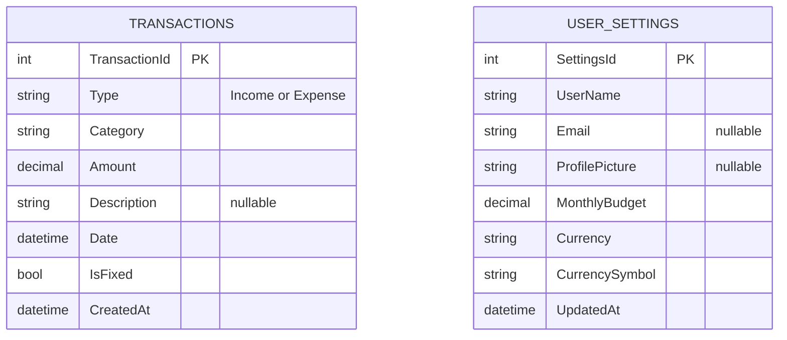

# Expense Tracker 💰

A personal finance web app built with ASP.NET Core MVC and MySQL to record income and expenses, track a monthly budget, and export monthly reports to Excel.

---

## Summary and Problem

Many people track spending in notes apps or memory, and at the end of the month they cannot say where the money went. Spreadsheets work, but they need manual formulas and are tedious to keep up.

Expense Tracker gives one place to log income and expenses, mark recurring (fixed) expenses, set a monthly budget, and see the month as charts and category totals. Any month's data can be downloaded as a formatted Excel report.

## Features

- **Dashboard:** total income, total expense, and balance for the selected month, with a 6-month income vs. expense trend and category charts
- **Add expenses:** categories include Food, Transport, Shopping, Entertainment, Health, Education, Bills, Rent, and Other
- **Add income:** categories include Salary, Business, Freelance, Investment, Gift, Bonus, and Other
- **Fixed expenses:** mark an expense as recurring and view fixed expenses by month with category totals
- **Monthly overview:** view all transactions for any of the last 12 months, with income and expense breakdowns by category
- **Excel export:** download a monthly report with a Summary sheet and an All Transactions sheet (built with ClosedXML)
- **Budget tracking:** set a monthly budget and see the amount spent, the amount remaining, and the percentage used
- **Currency settings:** choose BDT, USD, EUR, GBP, or INR; the symbol updates across the app

## Architecture



- The app follows the **MVC** pattern: controllers handle requests, Razor views render pages, and models map to database tables.
- `BaseController` loads the user's currency settings and passes them to every view.
- Entity Framework Core talks to MySQL through `ApplicationDbContext`, with schema changes managed by migrations.
- Charts are drawn in the browser with Chart.js from data prepared by the controllers.

## Database (ERD)



The two tables are independent. There is a single settings row for the whole app, and transactions are not linked to a user.

## Tech Stack

| Layer | Technology |
|---|---|
| Framework | ASP.NET Core MVC (.NET 8) |
| Language | C# |
| Database | MySQL |
| ORM | Entity Framework Core 8 with Pomelo MySQL provider |
| Frontend | Razor views, Bootstrap, jQuery, Chart.js |
| Excel export | ClosedXML |
| Icons | Font Awesome |

## Project Structure

```
ExpenseTracker/
├── ExpenseTracker.sln
└── ExpenseTracker/
    ├── Controllers/
    │   ├── BaseController.cs          # Loads currency settings for all views
    │   ├── HomeController.cs          # Dashboard and charts
    │   ├── ExpenseController.cs       # Add expense, fixed expenses
    │   ├── IncomeController.cs        # Add and delete income
    │   ├── MonthlyOverviewController.cs   # Monthly view and Excel export
    │   └── SettingsController.cs      # Budget, currency, profile
    ├── Models/
    │   ├── Transaction.cs
    │   └── UserSettings.cs
    ├── Data/
    │   └── ApplicationDbContext.cs
    ├── Migrations/                    # EF Core migrations
    ├── Views/                         # Razor views per controller
    ├── wwwroot/                       # CSS, JS, static libraries
    ├── appsettings.json               # Connection string
    └── Program.cs
```

## Demo Credentials

This app has no login, so there are no demo credentials. Open the app and start adding transactions. The first visit to **Settings** creates the default settings (user name, BDT currency, budget 0).

For the database connection you need your own local MySQL account: `<your-mysql-username>` / `<your-mysql-password>`.

## Run and Tests

**Prerequisites**
- .NET 8 SDK
- MySQL Server running locally

**1. Clone the repository**
```bash
git clone https://github.com/arrahmanriju/ExpenseTracker.git
cd ExpenseTracker/ExpenseTracker
```

**2. Configure the database connection**

Edit `ExpenseTracker/appsettings.json`:
```json
"ConnectionStrings": {
  "DefaultConnection": "Server=localhost;Database=ExpenseDB;User=<your-mysql-username>;Password=<your-mysql-password>;"
}
```

**3. Apply migrations**
```bash
cd ExpenseTracker
dotnet ef database update
```
This creates the `ExpenseDB` tables. If `dotnet ef` is not installed, run `dotnet tool install --global dotnet-ef` first.

**4. Run the app**
```bash
dotnet run
```
Then open `http://localhost:5210` in your browser.

**Tests:** this project has no automated tests yet. See Next Improvements.

## API Overview

This is a server-rendered MVC app, so it exposes pages and form actions rather than a JSON API.

| Route | Method | Purpose |
|---|---|---|
| `/` or `/Home/Index?month=&year=` | GET | Dashboard for a month |
| `/Expense/AddExpense` | GET, POST | Show the form / save an expense |
| `/Expense/FixedExpense?month=&year=` | GET | Fixed expenses for a month |
| `/Expense/DeleteFixedExpense/{id}` | GET | Delete a fixed expense |
| `/Income/Index?month=&year=` | GET | Income list and form for a month |
| `/Income/AddIncome` | POST | Save an income |
| `/Income/DeleteIncome/{id}` | GET | Delete an income |
| `/MonthlyOverview/Index?month=&year=` | GET | All transactions for a month |
| `/MonthlyOverview/ExportToExcel?month=&year=` | GET | Download the Excel report |
| `/Settings/Index` | GET | View settings and budget usage |
| `/Settings/UpdateSettings` | POST | Save settings |

## Deployment

The app is currently run locally. To host it:

1. Publish the app with `dotnet publish -c Release`.
2. Deploy to a host that supports ASP.NET Core, such as Azure App Service or a Windows/Linux server with IIS or Nginx.
3. Provide a hosted MySQL database and set `ConnectionStrings__DefaultConnection` as an environment variable instead of keeping it in `appsettings.json`.
4. Run `dotnet ef database update` against the production database.

## Key Decisions

- **ASP.NET Core MVC with Razor views:** keeps the app simple, with server-side rendering and no separate frontend project.
- **One `Transaction` table for both income and expenses:** a `Type` column separates them, which makes monthly totals and reports simple queries.
- **`IsFixed` flag for recurring expenses:** a single boolean marks fixed expenses without a separate recurring-payments table.
- **Entity Framework Core migrations:** schema changes are tracked in code and are easy to reproduce on another machine.
- **`BaseController` for shared settings:** the currency symbol is loaded in one place instead of repeated in every controller.
- **ClosedXML for export:** produces formatted Excel files without needing Excel installed on the server.

## Known Limitations

- No authentication or multiple users; all data is shared in one database
- Budget settings are a single row, so there is no per-category budget
- Delete actions use GET requests instead of POST, which is less safe
- Fixed expenses are entered manually each month and are not created automatically
- No edit option for existing transactions
- No automated tests
- The database password is stored in `appsettings.json` for local development

## Next Improvements

- User registration and login with per-user data
- Edit transactions and make delete actions POST requests
- Automatically create fixed expenses every month
- Per-category budgets and alerts when a budget is exceeded
- Unit and integration tests
- Cloud deployment with secrets in environment variables
- Custom categories

## Contributing

Contributions, issues, and feature requests are welcome. Check the [issues page](https://github.com/arrahmanriju/ExpenseTracker/issues).

## License

`<add your license, for example
