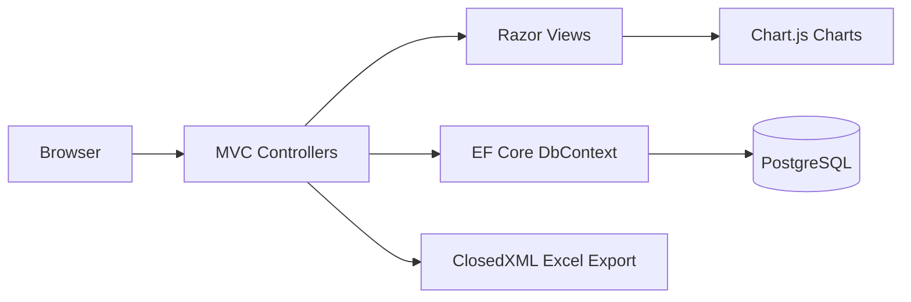
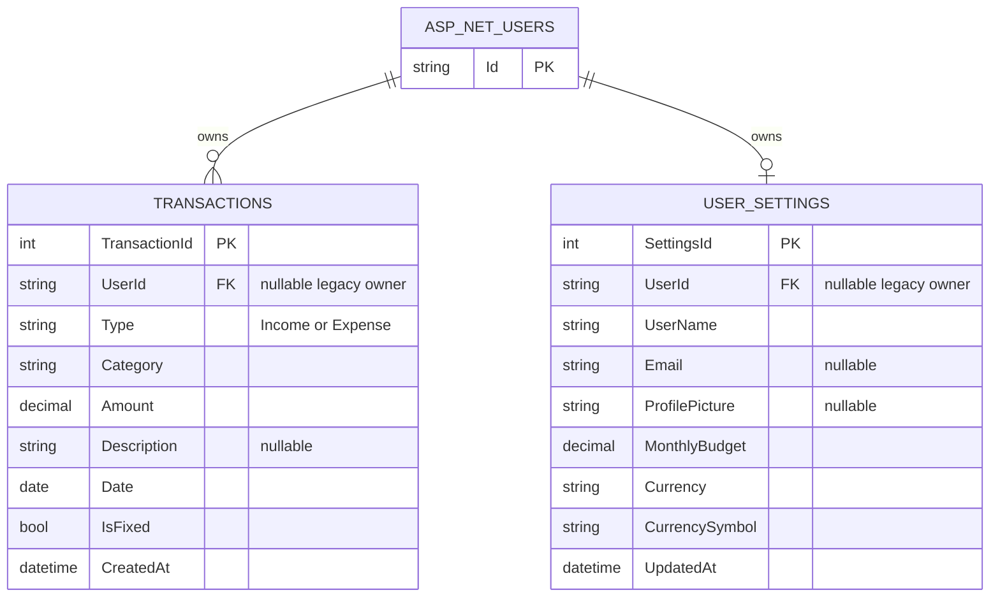

# Expense Tracker 💰

A personal finance web app built with ASP.NET Core MVC and PostgreSQL to record income and expenses, track a monthly budget, and export monthly reports to Excel.

---

## Summary and Problem

Many people track spending in notes apps or memory, and at the end of the month they cannot say where the money went. Spreadsheets work, but they need manual formulas and are tedious to keep up.

Expense Tracker gives one place to log income and expenses, mark recurring (fixed) expenses, set a monthly budget, and see the month as charts and category totals. Any month's data can be downloaded as a formatted Excel report.

## Features

- **Dashboard:** total income, total expense, and balance for the selected month, with a 6-month income vs. expense trend and category charts
- **Accounts:** register, log in, and log out. Dashboards, reports, transactions, and settings are scoped to the signed-in account.
- **Add and edit expenses:** categories include Food, Transport, Shopping, Entertainment, Health, Education, Bills, Rent, and Other
- **Add and edit income:** categories include Salary, Business, Freelance, Investment, Gift, Bonus, and Other
- **Fixed expenses:** mark an expense as recurring and view fixed expenses by month with category totals
- **Monthly overview:** view all transactions for any of the last 12 months, with income and expense breakdowns by category
- **Excel export:** download a monthly report with a Summary sheet and an All Transactions sheet (built with ClosedXML)
- **Budget tracking:** set a monthly budget and see the amount spent, the amount remaining, and the percentage used
- **Currency settings:** choose BDT, USD, EUR, GBP, or INR; the symbol updates across the app

## Architecture



- The app follows the **MVC** pattern: controllers handle requests, Razor views render pages, and models map to database tables.
- `BaseController` loads the user's currency settings and passes them to every view.
- Entity Framework Core talks to PostgreSQL through `ApplicationDbContext`, with schema changes managed by migrations.
- Charts are drawn in the browser with Chart.js from data prepared by the controllers.

## Database (ERD)



ASP.NET Core Identity stores accounts in the same database. Both tables carry an owner ID, and each account can have one settings row.

## Tech Stack

| Layer | Technology |
|---|---|
| Framework | ASP.NET Core MVC (.NET 8) |
| Language | C# |
| Database | PostgreSQL |
| ORM | Entity Framework Core 8 with Npgsql |
| Frontend | Razor views, Bootstrap, jQuery, Chart.js |
| Excel export | ClosedXML |
| Icons | Font Awesome |

## Project Structure

```
ExpenseTracker/
├── ExpenseTracker.sln
└── ExpenseTracker/
    ├── Controllers/
    │   ├── BaseController.cs          # Loads currency settings for all views
    │   ├── HomeController.cs          # Dashboard and charts
    │   ├── ExpenseController.cs       # Add expense, fixed expenses
    │   ├── IncomeController.cs        # Add and delete income
    │   ├── MonthlyOverviewController.cs   # Monthly view and Excel export
    │   └── SettingsController.cs      # Budget, currency, profile
    ├── Models/
    │   ├── Transaction.cs
    │   └── UserSettings.cs
    ├── Data/
    │   └── ApplicationDbContext.cs
    ├── Migrations/                    # EF Core migrations
    ├── Views/                         # Razor views per controller
    ├── wwwroot/                       # CSS, JS, static libraries
    ├── appsettings.json               # Logging configuration
    └── Program.cs
```

## Run locally from VS Code

Install the .NET 8 SDK. Use an empty PostgreSQL database on a local server, or start PostgreSQL 16 with Docker from the repository root in PowerShell.

```powershell
$env:POSTGRES_PASSWORD = [Guid]::NewGuid().ToString('N')
docker run -d --name hishaber-postgres -p 127.0.0.1:5432:5432 `
    -e POSTGRES_PASSWORD -e POSTGRES_DB=expense_tracker `
    -v hishaber-postgres-data:/var/lib/postgresql/data postgres:16
docker logs hishaber-postgres
```

Wait for PostgreSQL to accept connections. Record the generated password in your local secret configuration while it is available in the shell. For an installed PostgreSQL server, supply the host, port, database, username, and password for that server.

```powershell
$project = './ExpenseTracker/ExpenseTracker/ExpenseTracker.csproj'
$connection = "Host=127.0.0.1;Port=5432;Database=expense_tracker;Username=postgres;Password=$env:POSTGRES_PASSWORD"
@{ 'ConnectionStrings:DefaultConnection' = $connection } |
    ConvertTo-Json -Compress |
    dotnet user-secrets set --project $project
Remove-Item Env:POSTGRES_PASSWORD
Remove-Variable connection
dotnet tool restore
dotnet tool run dotnet-ef -- database update --project $project -- --environment Development
dotnet run --project $project
```

Open <http://localhost:8080> and register an account. You can also set the `ConnectionStrings__DefaultConnection` environment variable to a native Npgsql connection string. Apply migrations separately using a schema owner. The web application does not apply them at startup.

### Verify PostgreSQL

Set `EXPENSETRACKER_TEST_POSTGRESQL` to a native Npgsql connection string for an isolated PostgreSQL test server. The test role needs permission to create databases. The suite creates a uniquely named `expense_tracker_test_*` database and leaves it available for inspection. Use a disposable server for test runs.

```powershell
$solution = './ExpenseTracker/ExpenseTracker.sln'
dotnet restore $solution
dotnet build $solution --no-restore
dotnet test $solution --no-build -- RunConfiguration.TreatNoTestsAsError=true
dotnet tool run dotnet-ef -- migrations has-pending-model-changes --project $project -- --environment Development
```

For a browser check, use two test accounts and a fresh database.

1. Register account A, sign out, and sign back in. Confirm the password and account survive a restart.
2. In the current month, create income of 100.50 and a fixed expense of 30.25. Edit the expense to 25.25 and verify the change in the fixed-expense list and monthly overview.
3. Check dashboard income of 100.50, expenses of 25.25, and a balance of 75.25. Set a monthly budget of 100 and confirm spending of 25.25, remaining budget of 74.75, and usage of 25.25%.
4. Export the month to Excel. Compare the summary and transaction rows with the dashboard and monthly overview.
5. Register account B in a separate browser session. Verify its dashboard, ledger, settings, and export are scoped to B. Try opening A's transaction edit URL and submitting an edit as B. Confirm A's data stays intact.
6. Return to account A, delete the fixed expense and income, and confirm the dashboard, budget, and report reflect the deletions.

### Preserve existing MySQL records

The four original migrations and snapshot are archived under `ExpenseTracker/Migrations/MySql` outside the web project. EF runs the separate PostgreSQL baseline under the web project's `Migrations/PostgreSql` and records it in `__EFMigrationsHistoryPostgreSql`. The baseline creates the schema for a fresh database.

If existing records are needed, agree on a copy plan with the data owner and **obtain explicit approval before any import, deletion, or modification of existing records**, including ownership backfills.

1. Identify the source schema version and take a consistent MySQL backup. Capture row counts, ownership counts, and exact income, expense, and budget totals by user and month. Record which rows predate Identity.
2. Rehearse the approved copy into an isolated PostgreSQL database initialized with the baseline. Export using a read-only MySQL account. Keep exported personal data and Identity hashes in restricted storage.
3. Load into staging and validate conversions before inserting into application tables. Preserve Identity IDs, normalized credentials, password hashes, security stamps, and dependent Identity rows if present. Load users and roles before dependent records. Keep transaction and settings IDs, map booleans to PostgreSQL booleans, copy transaction calendar dates and wall-clock audit timestamps, and treat Identity lockout timestamps as UTC. Flag zero or invalid dates, time components on transaction dates, duplicate normalized identities, orphaned foreign keys, multiple settings rows for an owner, noncanonical transaction types or currency codes, and amounts outside the .NET decimal range. PostgreSQL uses exact `numeric` without a fixed scale, and application forms continue to accept up to two decimal places. Strip trailing fractional zeros from exported MySQL decimals, verify each value and its report totals can round-trip through .NET decimal, and preserve UTF-8 text.
4. Keep ownerless rows unassigned until ownership is approved. Compare row counts, IDs, NULL owners, decimal totals, and per-user reports. After inserting explicit IDs, reset the PostgreSQL sequences for transactions, settings, and Identity claims to continue above the maximum imported IDs. Test sign-in with a consenting migrated account and verify new writes receive fresh IDs.
5. At cutover, pause writes, repeat the verified copy from a consistent source, reconcile the same checks, then switch Render to PostgreSQL. Keep the MySQL backup and deployment configuration for recovery. If PostgreSQL has accepted writes, reconcile those writes before switching back.

## API Overview

This is a server-rendered MVC app, so it exposes pages and form actions rather than a JSON API.

| Route | Method | Purpose |
|---|---|---|
| `/` or `/Home/Index?month=&year=` | GET | Dashboard for a month |
| `/Expense/AddExpense` | GET, POST | Show the form / save an expense |
| `/Expense/FixedExpense?month=&year=` | GET | Fixed expenses for a month |
| `/Expense/DeleteFixedExpense/{id}` | POST | Delete an owned fixed expense |
| `/Income/Index?month=&year=` | GET | Income list and form for a month |
| `/Income/AddIncome` | POST | Save an income |
| `/Income/DeleteIncome/{id}` | POST | Delete an owned income |
| `/Transactions/Edit/{id}` | GET, POST | Edit owned income or expense |
| `/MonthlyOverview/Index?month=&year=` | GET | All transactions for a month |
| `/MonthlyOverview/ExportToExcel?month=&year=` | GET | Download the Excel report |
| `/Settings/Index` | GET | View settings and budget usage |
| `/Settings/UpdateSettings` | POST | Save settings |
| `/Account/Register`, `/Account/Login` | GET, POST | Register or sign in |
| `/Account/Logout` | POST | Sign out |
| `/health` | GET | Anonymous health probe |

## Deployment

For a Render Free Docker Web Service, follow the [Render deployment guide](docs/render-deployment.md) for Neon TLS setup, environment variables, database initialization, and session persistence.

### Other hosts

1. Build the existing Dockerfile for Railway, or publish with `dotnet publish -c Release`.
2. Configure `ConnectionStrings__DefaultConnection` as a deployment secret. Use a least-privilege database account for runtime and rotate any credential previously stored in the repository.
3. Apply the reviewed migration separately with a deployment credential. The app starts without applying migrations automatically.
4. Serve the app over HTTPS and use `/health` for the host health probe. Persist ASP.NET Core Data Protection keys across restarts where users need sessions to survive redeployment.

## Key Decisions

- **ASP.NET Core MVC with Razor views:** keeps the app simple, with server-side rendering and no separate frontend project.
- **One `Transaction` table for both income and expenses:** a `Type` column separates them, which makes monthly totals and reports simple queries.
- **`IsFixed` flag for recurring expenses:** a single boolean marks fixed expenses without a separate recurring-payments table.
- **Entity Framework Core migrations:** schema changes are tracked in code and are easy to reproduce on another machine.
- **`BaseController` for shared settings:** the currency symbol is loaded in one place instead of repeated in every controller.
- **ClosedXML for export:** produces formatted Excel files without needing Excel installed on the server.

## Known Limitations

- Fixed expenses are flagged entries and still need to be entered for each month.
- Currency settings change the display symbol. Historical amounts retain their original numeric values.
- Legacy rows need an explicit ownership assignment before they appear in the app.

## Next Improvements

- Automatically create fixed expenses for each month.
- Add per-category budgets and alerts.

## Contributing

Contributions, issues, and feature requests are welcome. Check the [issues page](https://github.com/arrahmanriju/ExpenseTracker/issues).

## License

`<add your license, for example
